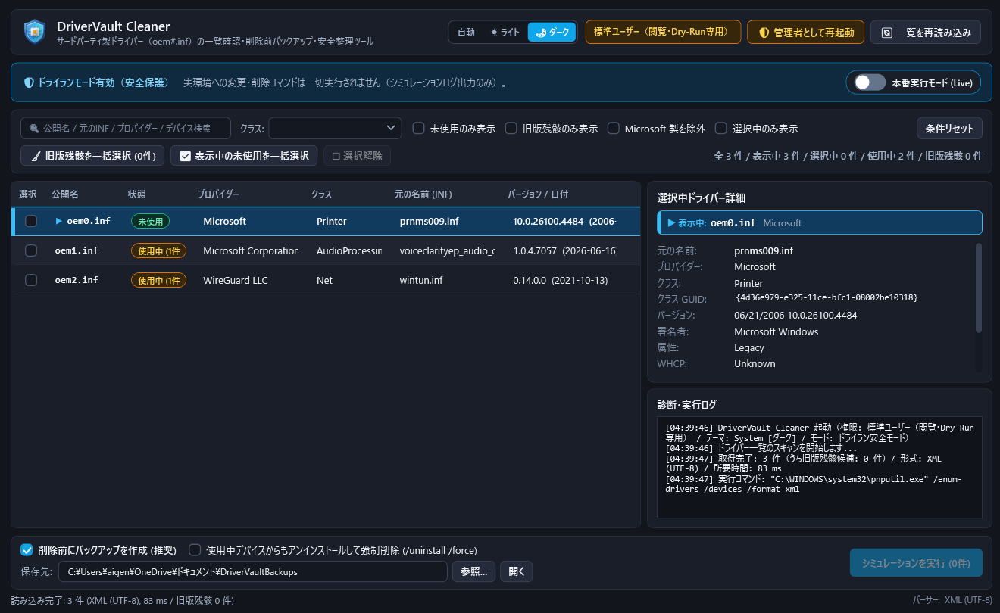
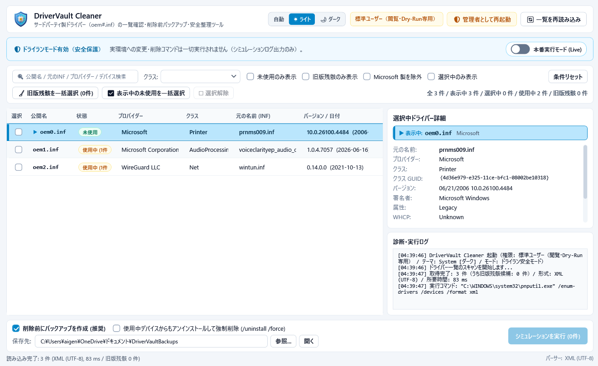

<div align="center">


# DriverVault Cleaner (Windows サードパーティ製ドライバー 安全整理・バックアップツール)

**Windows の Driver Store に登録されたサードパーティ製ドライバーを一覧確認し、削除前バックアップを取得してから安全に整理できるスタンドアロンツール**

[](https://github.com/777Labs/DriverVaultCleaner/releases)
[](https://github.com/777Labs/DriverVaultCleaner)
[](LICENSE)

[📥 最新版をダウンロード (Releases)](https://github.com/777Labs/DriverVaultCleaner/releases/latest)

</div>

---

## 📸 スクリーンショット

**ダークモード（システム連動 / ダーク）**



**ライトモード**



---

## ✨ 主な特徴

- 🚀 **完全スタンドアロン・ポータブル設計**:
  - インストール不要のポータブル設計。単一の実行ファイル（`DriverVaultCleaner.exe`）だけで即座に起動します。
- 🔍 **XML / CP932 ハイブリッド取得 & コンソール非表示**:
  - Windows 11 の UTF-8 XML 出力と Windows 10 等の日本語 CP932 / 英語テキスト出力の両方に対応し、`pnputil.exe` 呼び出し時にコマンドプロンプト画面がちらつきません。
- 🧹 **旧バージョン残骸の自動検出 & 一括選択**:
  - 同じプロバイダー・クラス・元の INF 名の中でより新しい版が別に存在する未使用ドライバーを「**旧版残骸**」として識別し、ワンクリックで一括選択できます（使用中デバイスがあるドライバーは除外）。
- 💾 **削除前バックアップ & 復元スクリプト自動生成（フェイルセーフ）**:
  - 削除前に `pnputil.exe /export-driver` で対象ドライバーをセッションフォルダへ退避し、管理者実行で戻せる `restore_drivers.bat`・`manifest.json`・`RESTORE_GUIDE.txt` を生成します。
  - バックアップに失敗したドライバーは**削除コマンドを自動スキップ**して保護します。
- 🛡️ **多重安全設計（ドライラン既定 & 二段階確認）**:
  - 起動時は必ず **ドライランモード（シミュレーションのみ）** で開始し、実環境への変更・削除は行いません（本番モード状態は保存されません）。
  - 本番実行モードへの切り替え時・強制削除オプション有効化時・実行直前のそれぞれで確認ダイアログを表示し、`/reboot` による強制再起動も行いません。
- 🌓 **ダークモード対応（自動 / ライト / ダーク）& ウィンドウ記憶**:
  - Windows 11 のテーマ設定に連動し、ヘッダーからワンクリック切り替え可能。ウィンドウの表示位置・サイズ・最大化状態も記憶し、二重起動時は既存ウィンドウを最前面に復元します。

---

## 📥 ダウンロードと使い方

### 1. ダウンロード
右側の [**Releases**](https://github.com/777Labs/DriverVaultCleaner/releases) ページから最新の `DriverVaultCleaner-v1.0.0-win-x64.zip`（または `DriverVaultCleaner.exe`）をダウンロードしてください。

### 2. 起動・操作方法
1. ダウンロードした ZIP ファイルをお好みのフォルダーに展開（解凍）します。
2. 展開されたフォルダー内の `DriverVaultCleaner.exe` をダブルクリックして起動します（標準ユーザーのまま一覧閲覧・検索・ドライランが可能です）。
3. 検索やフィルタ（`未使用のみ表示` / `旧版残骸のみ表示` / `Microsoft 製を除外`）で整理対象を選び、チェックボックスを選択します。
4. まずドライランのまま **「シミュレーションを実行」** を押して、右下のログで実行予定コマンドを確認します。
5. 実際に整理する場合は、**「🛡️ 管理者として再起動」** で管理者権限へ昇格したうえで **「本番実行モード (Live)」** スイッチを ON にし、バックアップ設定を確認して **「バックアップして削除を実行」** を行います。

### 3. バックアップからの復元方法
退避先フォルダ（既定: `ドキュメント\DriverVaultBackups\Backup_yyyyMMdd_HHmmss\`）から復元できます。
- **一括復元（推奨）**: フォルダ内の `restore_drivers.bat` を右クリック → **「管理者として実行」**
- **個別復元**: 管理者ターミナルで `pnputil /add-driver "<サブフォルダ>\<元のINF名>" /install`
- **デバイスマネージャー**: 対象デバイスを右クリック → `[ドライバーの更新]` → セッションフォルダを指定（サブフォルダー検索有効）

---

> [!IMPORTANT]
> ### 🛡️ Windows SmartScreen 警告が出た場合
> インターネットから新しくダウンロードしたアプリを初めて起動する際、Windows によって「**Windows によって PC が保護されました**」という青い画面が表示される場合があります。
> 
> これは個人開発のフリーソフトにおいてデジタル署名が未知であるために表示される標準的なセキュリティ確認画面です。以下の手順でそのまま起動できます：
> 1. 画面内の「**詳細情報**」リンクをクリックします。
> 2. 右下に表示される「**実行**」ボタンをクリックします。
> （一度実行を許可すれば、次回以降はこの画面は表示されなくなります）

---

## 🎛️ 主な画面操作・フィルタ機能

| ボタン / フィルタ | 動作 |
| :--- | :--- |
| `🧹 旧版残骸を一括選択` | 表示中のうち、より新しい版が別に存在する未使用の旧バージョン残骸のみを選択 |
| `☑ 表示中の未使用を一括選択` | 表示中の未使用ドライバーを選択（使用中デバイスが紐付くものは除外） |
| `未使用のみ表示` / `旧版残骸のみ表示` | デバイス未割当のドライバー、または旧版残骸候補のみに絞り込み |
| `Microsoft 製を除外` | `Microsoft` / `Microsoft Corporation` 提供ドライバーを一覧から除外 |
| `本番実行モード (Live)` | 既定 `OFF`（安全ドライラン）。`ON` 切替時は警告ダイアログで確認 |
| `削除前にバックアップを作成 (推奨)` | 既定 `ON`。エクスポート失敗時は対象ドライバーの削除を自動スキップ |
| `自動` / `☀ ライト` / `🌙 ダーク` | 外観テーマを切り替え（`%LOCALAPPDATA%\DriverVaultCleaner\settings.json` に保存） |

---

## 💻 動作環境

- **OS**: Windows 10 (64-bit) / Windows 11 (64-bit)
- **ランタイム**: 不要（必要な .NET 8 ランタイムが exe に内包されているため、追加のランタイムインストールは不要です）

---

## 🛠️ ビルド手順 (開発者向け)

本プロジェクトをソースコードからビルドする場合は、**.NET 8 SDK** が必要です。

```powershell
# 自己完結型（単一実行ファイル）の発行例
dotnet publish .\src\DriverVaultCleaner\DriverVaultCleaner.csproj `
  -c Release `
  -r win-x64 `
  --self-contained true `
  -p:PublishSingleFile=true `
  -p:IncludeNativeLibrariesForSelfExtract=true `
  -p:EnableCompressionInSingleFile=true `
  -p:PublishReadyToRun=true `
  -o .\publish
```

---

## 📄 利用規約・ライセンス

本ソフトウェアは **無料（フリーウェア）** として提供されています。個人利用・商用利用を問わず、どなたでも無償でご利用いただけます。
詳細については [LICENSE](LICENSE) をご確認ください。

---

## 👤 作者 / お問い合わせ

- **開発者 / 団体名**: 777 Labs
- **Webサイト / GitHub**: [https://github.com/777Labs](https://github.com/777Labs)
- **不具合報告・ご要望**: [GitHub Issues](https://github.com/777Labs/DriverVaultCleaner/issues)
